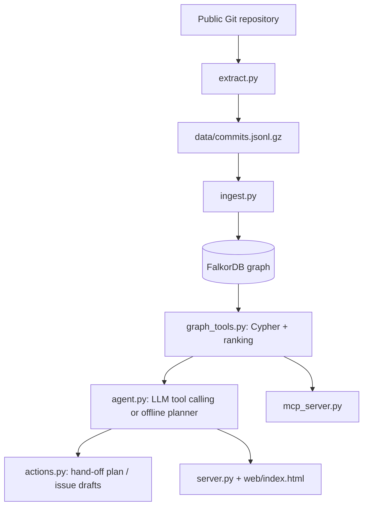

# HandoffGraph

**An agent that finds the files only one person understands, and plans the hand-off before that person leaves.**

HandoffGraph loads a repository's Git history into **FalkorDB** as a knowledge graph of contributors, files and modules. An agent then calls graph tools to answer questions such as *which modules depend on one person*, *what is orphaned if they leave*, and *who should inherit it*. It acts on the answer by writing a hand-off plan. Every answer ships with the Cypher that ran and the subgraph that justified it.

[](https://www.python.org/)
[](https://fastapi.tiangolo.com/)
[](https://www.falkordb.com/)

- **Live demo:** https://handoffgraph.onrender.com/
- **Blog post:** https://dev.to/komal_deep_355/what-breaks-when-your-best-engineer-leaves-i-asked-a-graph-4khg
- **Video link:** https://youtu.be/zoFgDCOhXvQ

---

## The problem

Important knowledge in a codebase often sits with one person. A module may have a single recent author, or a file may have no active alternative owner. When that person is unavailable, the team finds out the hard way. Static CODEOWNERS files don't show who has actually worked on what recently.

## What it does

| Capability | What the agent returns |
|---|---|
| Module key-person risk | Bus factor, top-owner share, share of knowledge held by inactive contributors, HIGH/MEDIUM/LOW label |
| Leave impact | Files that lose their last active expert if a given person leaves, grouped by module |
| Successor suggestions | Top candidates for a module, ranked by direct recent work plus co-change proximity in the graph |
| Path explanation | Shortest graph path from a person to a module |
| Key collaborators | PageRank over the collaboration graph |
| **Action** | Writes a Markdown hand-off plan to `out/` and drafts GitHub issues (real issues only if you opt in) |

Every tool call is shown in the UI with its Cypher, and the relevant subgraph is drawn live.

## How FalkorDB does the work

The agent knows nothing about the repository except what graph queries return. If FalkorDB is removed, every tool stops working.

| Agent decision | Graph feature used |
|---|---|
| Rank risky modules | `Contributor -[KNOWS]-> Module`, aggregated from `TOUCHED` edges |
| Orphaned files if X leaves | Multi-hop `OPTIONAL MATCH` over `TOUCHED`, restricted to *active* peers |
| Pick a successor | `File -[CO_CHANGED]- File` proximity plus direct `TOUCHED` ownership |
| Explain why | `shortestPath` from a contributor to a module |
| Find hubs | `algo.pageRank` on `COLLABORATES` |
| One graph per repo | Graph name is `owner__repo` (FalkorDB multi-graph) |

Honest split of responsibilities: the traversals and aggregations run in Cypher. The final ranking arithmetic (bus-factor cumulative sum, successor weighting) runs in Python on the rows Cypher returns.

The same tools are exposed three ways: the built-in agent (any OpenAI-compatible LLM, or an offline rule-based planner that needs no API key), an **MCP server** for MCP clients, and a web UI.

## Results on a real repository

Dataset: public history of [`fastapi/fastapi`](https://github.com/fastapi/fastapi), source files under `fastapi/` only. The graph has 855 commits, 209 contributors, 59 files and 7 modules (commit history through 18 Oct 2026).

- 6 of 7 modules have a bus factor of 1 under this heuristic.
- One contributor, Sebastián Ramírez, holds about 80% of recent-weighted knowledge in `fastapi/(core)` and 17 files across modules have no other active contributor with comparable recent history.
- Example graph path: `Sebastián Ramírez -[TOUCHED]-> fastapi/__init__.py -[IN_MODULE]-> fastapi/(core)`.

These numbers measure **commit history only**. They say nothing about reviews, design discussions, or the wider maintainer team, and they are not an assessment of any person. See [Limitations](#limitations).

## Architecture



## Graph data model

**Nodes**

| Node | Properties |
|---|---|
| `Contributor` | `id` (hash of email), `name`, `first_ts`, `last_ts`, `commits`, `active` |
| `File` | `path`, `module`, `commits`, `score` |
| `Module` | `name` |
| `Meta` | `repo`, `now`, `active_days`, `half_life` |

**Relationships**

| Relationship | Direction | Properties | Meaning |
|---|---|---|---|
| `TOUCHED` | Contributor → File | `commits`, `score`, `last_ts` | Recency-weighted work on a file |
| `IN_MODULE` | File → Module | none | Module membership (directory at depth 2) |
| `KNOWS` | Contributor → Module | `score` | Sum of `TOUCHED` scores in the module |
| `CO_CHANGED` | File → File | `n` | Files changed together in the same commit (n ≥ 2) |
| `COLLABORATES` | Contributor → Contributor | `w` | Shared files between regular contributors |

Scoring: each commit-file pair contributes `0.5 ** (age / half_life)` (default half-life 365 days). A contributor is *active* if their last commit is within `ACTIVE_DAYS` (default 365) of the newest commit in the dataset.

## Cypher queries and graph algorithms the product depends on

**1. Module risk** (`module_risk`)
```cypher
MATCH (m:Module)<-[k:KNOWS]-(c:Contributor)
WITH m, sum(k.score) AS total,
     collect({id:c.id, name:c.name, score:k.score, active:c.active}) AS owners
RETURN m.name, total, owners
```
Python then computes bus factor (fewest people covering 50% of `total`), top-owner share and inactive share. Label: HIGH if bus factor is 1 with a top share of at least 50%, or inactive share is at least 50%; MEDIUM if bus factor is at most 2 or inactive share is at least 30%; otherwise LOW.

**2. Orphaned files if a person leaves** (`leave_impact`)
```cypher
MATCH (p:Contributor {id:$id})-[t:TOUCHED]->(f:File)
OPTIONAL MATCH (f)<-[o:TOUCHED]-(q:Contributor)
  WHERE q.id <> $id AND q.active = true
WITH f, t.score AS mine, coalesce(sum(o.score), 0) AS others, count(q) AS active_peers
WHERE mine >= 0.75 AND others <= 0.25 * mine
RETURN f.path, f.module, mine, others, active_peers
ORDER BY mine DESC
```

**3. Successors, direct work** (`find_successors`)
```cypher
MATCH (q:Contributor)-[o:TOUCHED]->(f:File {module:$m})
WHERE q.id <> $id AND q.active = true
RETURN q.id, q.name, count(f), sum(o.score)
```

**4. Successors, co-change proximity** (`find_successors`)
```cypher
MATCH (p:Contributor {id:$id})-[:TOUCHED]->(f:File {module:$m})
      -[c:CO_CHANGED]-(g:File)<-[o:TOUCHED]-(q:Contributor)
WHERE q.id <> $id AND q.active = true
RETURN q.id, q.name, sum(c.n), count(DISTINCT g)
```
Candidates are ranked by `0.6 * direct_score + 0.4 * co_change_strength`, each normalised to its maximum.

**5. Explanation path** (`explain_path`)
```cypher
MATCH (a:Contributor {id:$id}), (m:Module {name:$m})
RETURN shortestPath((a)-[:TOUCHED|IN_MODULE*..3]->(m))
```

**6. Centrality** (`key_people`)
```cypher
CALL algo.pageRank('Contributor', 'COLLABORATES') YIELD node, score
RETURN node.id, node.name, node.active, score
ORDER BY score DESC LIMIT $n
```

## Quick start (Windows PowerShell)

Prerequisites: Git, Python 3.10+, Docker Desktop.

```powershell
git clone https://github.com/YOUR_GITHUB_USERNAME/HandoffGraph.git
cd HandoffGraph
python -m venv .venv
.\.venv\Scripts\Activate.ps1
pip install -r requirements.txt
copy .env.example .env
docker compose up -d          # FalkorDB on :6379, FalkorDB Browser on http://localhost:3000
.\scripts\run.ps1 ingest      # loads data/commits.jsonl.gz into FalkorDB
.\scripts\run.ps1 serve       # open http://localhost:8000
```

If PowerShell blocks the activate script for this session: `Set-ExecutionPolicy -Scope Process -ExecutionPolicy Bypass`.

**LLM mode (optional).** Put an API key in `.env` (`LLM_API_KEY`, plus `LLM_BASE_URL` and `LLM_MODEL`; the example file uses Gemini's OpenAI-compatible endpoint, and a local Ollama endpoint also works). With no key, the app runs in offline mode using a rule-based planner for the supported question patterns.

**Rebuild the dataset or use another repository.** Set `TARGET_REPO`, `SRC_PREFIXES` and `SRC_EXTS` in `.env`, then run `.\scripts\run.ps1 extract` followed by `ingest`. Each repository gets its own graph.

**MCP server.** `.\scripts\run.ps1 mcp` starts a stdio MCP server exposing the same tools.

### Smoke test
1. Open http://localhost:8000 and ask "Which modules are most at risk?".
2. Ask "What happens if Sebastián Ramírez leaves?" and expand the graph trace.
3. Ask "Make a hand-off plan for Sebastián Ramírez" and check `out/` for the generated file.
4. Open FalkorDB Browser at http://localhost:3000 and run any query above against the graph `fastapi__fastapi`.

## Configuration

| Variable | Purpose | Default |
|---|---|---|
| `TARGET_REPO` | Repository to analyse (`owner/name`) | `fastapi/fastapi` |
| `SRC_PREFIXES`, `SRC_EXTS` | Which paths and extensions to include | `fastapi/`, `.py` |
| `MODULE_DEPTH` | Directory depth used to define a module | `2` |
| `HALF_LIFE_DAYS`, `ACTIVE_DAYS` | Recency weighting and activity window | `365`, `365` |
| `FALKORDB_HOST`, `FALKORDB_PORT`, `FALKORDB_PASSWORD` | Database connection | `localhost`, `6379`, empty |
| `LLM_BASE_URL`, `LLM_MODEL`, `LLM_API_KEY` | Optional OpenAI-compatible LLM | empty key = offline mode |
| `GITHUB_TOKEN`, `GITHUB_ISSUE_REPO` | Optional: open real issues in **your own sandbox repo** | empty (dry run) |

Never commit `.env`. Issue creation is dry-run unless a token and sandbox repo are set **and** the UI checkbox is ticked. Never point it at a repository you don't own.

## API

| Route | Purpose |
|---|---|
| `GET /api/meta` | Repository, graph name, and mode (`llm` or `offline`) |
| `POST /api/ask` | Body `{"question": "...", "open_issues": false}`. Returns `answer`, `trace` (tools, args, Cypher, data), `viz` (nodes, edges) |
| `GET /` | Web UI |
| `GET /docs` | Interactive FastAPI documentation |

## Project structure

```text
HandoffGraph/
├── README.md
├── requirements.txt
├── docker-compose.yml          # FalkorDB (:6379) + FalkorDB Browser (:3000)
├── .env.example
├── .gitignore
├── data/
│   └── commits.jsonl.gz        # fastapi/fastapi commit history
├── out/                        # generated hand-off plans
├── scripts/
│   └── run.ps1                 # extract | ingest | serve | mcp
├── src/busfactor/
│   ├── config.py               # settings, module grouping, DB connection
│   ├── extract.py              # git history -> dataset
│   ├── ingest.py               # dataset -> FalkorDB graph
│   ├── graph_tools.py          # Cypher tools
│   ├── actions.py              # hand-off plan + optional GitHub issues
│   ├── agent.py                # LLM tool calling + offline planner
│   ├── server.py               # FastAPI backend
│   └── mcp_server.py           # MCP server
└── web/
    └── index.html              # chat UI + live graph
```

`.cache/` (local repo clone) and `.venv/` are created when you run the project and are not committed. The Python package is named `busfactor`.

## Limitations

- Ownership is inferred from commit history. Commit counts are not expertise; reviews, design discussions, issues and docs are not in the graph.
- Identity merging uses author email only, so one person with two emails appears as two contributors. Bot accounts are filtered by name pattern, which is imperfect.
- Risk scores, thresholds and the half-life are heuristics, not calibrated probabilities.
- Co-change does not prove a code dependency. For a module owned entirely by one person, successor suggestions rely only on co-change links to other modules and are weak.
- The offline planner handles a limited set of question patterns. LLM answers can be wrong; check them against the trace.
- `algo.pageRank` depends on the FalkorDB version supporting that procedure.
- Not tested at large-repository scale.

## Data and privacy

Only public Git metadata is used: author name, a hash of the author email, commit time, and changed file paths for the configured source files. Raw emails are not stored. Merge commits, bot commits and commits touching more than 40 files are dropped. Results describe a public repository's commit history and are not a performance evaluation of any individual.
